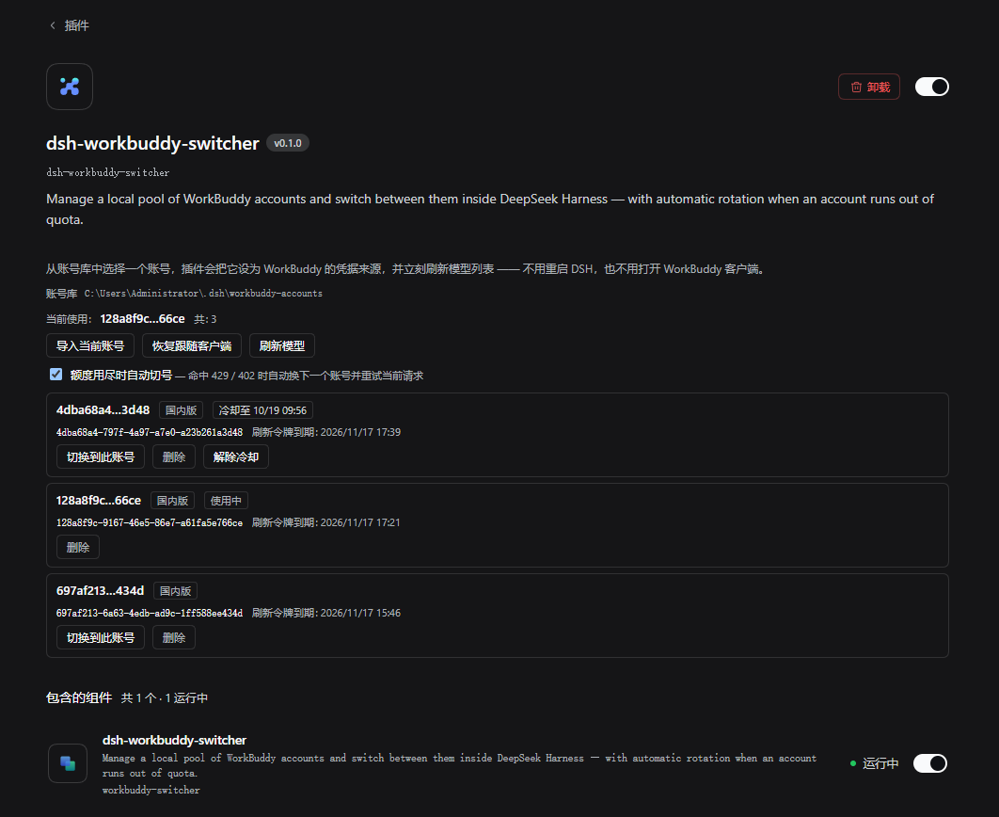
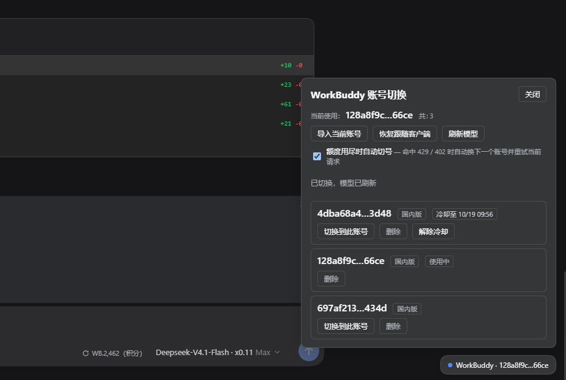
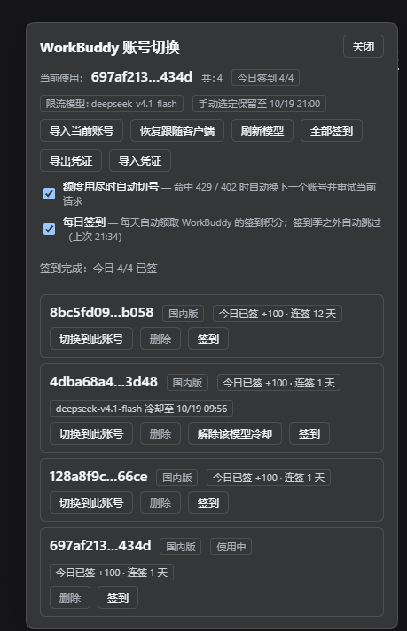
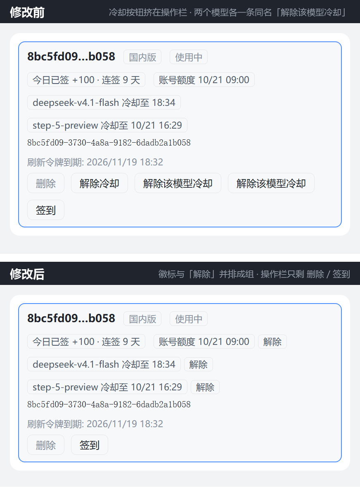

# DSH WorkBuddy Switcher

[English](./README.en.md) | 中文

在 DeepSeek Harness 里管理一组 WorkBuddy 账号，随时切换；**账号额度用尽时自动换号并重试当前请求**。

一个插件装完就能用：把 WorkBuddy 的模型接进 DSH 的那部分（模型提供者、凭据读取、用量与签到接口）已经内置在本包里，不需要再装别的东西。

---

## 解决的痛点

WorkBuddy 一次只能使用一个账号，切换账号要么重开 WorkBuddy 客户端登录，要么手改配置文件。而 WorkBuddy 每天有额度上限，一个账号用完后当天就不能再用了。

多台机器（比如公司和家里）之间，账号库还是各自独立的——在 A 机器上登录过的账号，B 机器上得重新登录一遍。

本插件做五件事：

1. **账号库**——把每个账号的登录凭据存档到本地，之后切换不需要再打开客户端
2. **一键切换**——设置页卡片或右下角悬浮按钮，切换后模型列表立刻刷新
3. **自动轮换**——命中额度限制时，自动换下一个账号并重试，你几乎感觉不到中断
4. **跨机器同步**——导出一个文件，在另一台机器导入，账号库就对齐了
5. **每日自动签到**——每个账号每天自动领 100 积分，关机错过会在开机后补上

## 功能

### 账号库与切换

- 归档目录：`~/.dsh/workbuddy-accounts/`，一个账号一个 JSON
- 账号行的标题是**打码手机号**（如 `180****0331`），不再是 uid 片段——同一台机器上挂着几个号时，只有手机号能让你一眼认出是哪个
- 这个号码 WorkBuddy 服务端**只下发打码形态**，插件也只存、只渲染这一形态：解析器会明确拒绝完整号码，所以这个插件不可能显示出一个能拨通的手机号
- 客户端当前登录的账号会**自己进列表并存档**，不用点「导入当前账号」；那个按钮仍然留着，只在插件读不到客户端时才用（见[添加账号](#添加账号)）
- 同一账号的多份副本会自动去重，只显示规范文件
- 界面每 10 秒自动刷新

### 跨机器同步（导出 / 导入）

在公司和家里各用一台机器时，用它同步账号：

- **导出凭证**——把整个账号库打包成一个文件下载
- **导入凭证**——选一个导出文件，合并进本机账号库

**导入是合并，不是覆盖**，规则如下：

| 情况 | 处理 |
|---|---|
| 本机没有该账号 | 新增 |
| 本机有，且**导出文件**的刷新令牌更晚 | 替换（旧文件先备份成 `<uid>.json.imported-<时间戳>`） |
| 本机有，且**本机**的更晚 | 保留本地，不动 |

最后一条是关键：**在导出它的那台机器上重新导入同一个文件，不会把自己登出**。

> ⚠️ **导出文件是明文令牌**，等同于这些账号的登录凭据。请只放进你自己的加密存储，用完删掉。
>
> 提醒：凭证一旦离开本机，**无法远程吊销**。WorkBuddy 服务端只有账号级吊销（改密码），没有按会话/设备踢人的接口。

### 自动轮换

命中额度限制时自动换号，规则如下：

| 上游返回 | 处理 | 原因 |
|---|---|---|
| `429 soft_rate`（**没有**积分措辞） | ✅ 只冷却**这个模型**，换号并重试 | 换账号能立刻恢复；但同账号的其它模型仍可用 |
| `429 soft_rate` + 积分措辞 | ✅ 冷却**整个账号**，换号并重试 | 实际是积分用尽，只是状态码写成了 429 |
| `402 hard_credit` | ✅ 冷却**整个账号**，换号并重试 | 同上 |
| `401` / `12153` | ❌ 不换号 | 换账号解决不了，需要重新登录 |
| 内容审核拦截 | ❌ 不换号 | 与账号无关 |
| `5xx` | ❌ 不换号 | 交给 `dsh-llm-retry` 退避重试 |

#### 限额标记跟模型绑定

这是本插件和「一遇 429 就把账号判死」的关键区别。

WorkBuddy 对**单个模型被限流**和**账号积分用尽**返回的是同一个 `429 soft_rate`，
光看状态码分不出来。所以冷却记在**实际被限制的那个范围**上：

| 判定依据 | 冷却范围 |
|---|---|
| `402` / 消息里出现「积分不足、额度不足、quota exceeded」等 | 整个账号（所有模型） |
| 只有 `429 soft_rate` | 只有失败请求所用的那个模型 |
| 拿不到失败的模型名 | 整个账号（宁可保守） |

后果是：某账号在 `claude-sonnet-4-5` 上被限流后，

- 它会从**这个模型**的候选里退出，请求换到别的账号；
- 但它在**其它模型**上仍是健康账号，仍然参与轮换和回收；
- 界面上的标记也会写成「模型名 冷却至 …」，而不是让整个账号看起来都没额度了。

冷却时长：

- 上游消息带「将在 … 重置」→ **精确冷却到那一刻**
- 没有重置时间 → 第 1-2 次冷却 10 分钟，第 3 次起 24 小时

冷却状态持久化，重启不丢；到期自动失效，并通过每分钟一次的扫描**自动切回**更优的账号。

### 每日自动签到

账号库里的每个账号每天自动领一次签到积分（当前是 **100 积分/天**），不需要打开 WorkBuddy 客户端。

- **开机补签**——启动 90 秒后跑一次，之后每 30 分钟扫一次；昨晚关机错过的那次，开机就补上
- **幂等**——上游按天去重，重复领只会返回「今天已签到」，不会多给也不会重复扣
- **只对能用得上的账号发请求**——国际版（WorkBuddy AI）没有这个活动，直接标「不适用」，不发请求
- **签到季感知**——活动结束后（`active: false`）每天最多查一次状态，界面显示结束日期
- **看不懂的失败不会拖垮别的**——一个账号 401 / 超时只影响它自己，其余账号照常签，轮换和回收完全不受影响

界面上每个账号一行标签：`已领 +100 · 连签 3 天` / `今日已签 +100 · 连签 12 天` /
`签到失败 · 令牌失效` / `签到季未开启 · 10-31 结束`；顶部有 `今日签到 3/4` 的汇总，
底部是「每日自动签到」开关和「全部签到」按钮，每个账号卡片上还有单独的「签到」按钮。

> **令牌会自己续**：签到遇到 401 时，插件用存档里的刷新令牌换一个新的 access token，
> 原子写回存档（写回前会比对文件是否被别人改过，被改过就放弃本次写回）。
> 这是为了让长期没被选中、不参与对话的账号也不会因为令牌过期而签不上。

#### 签到结果的含义

| 标签 | 含义 | 后续 |
|---|---|---|
| `已领 +100` | 这次真的领到了 | 今天不再请求这个账号 |
| `今日已签 +100` | 今天之前已经领过（可能是客户端领的） | 今天不再请求 |
| `签到季未开启` | 活动没开或已结束 | 今天最多查一次 |
| `国际版无签到` | WorkBuddy AI 没有这个活动 | 不发请求 |
| `签到失败 · 令牌失效` | 401/403，刷新令牌也没救回来 | 不再重试，需要重新登录该账号 |
| `签到失败 · 网络异常` | 超时 / 5xx / 429 | 10 / 30 / 60 分钟后重试 |
| `签到失败 · 异常` | 其它业务错误 | 同样退避重试，鼠标悬停看原始 `msg` |

#### 手动签到

- **「全部签到」**——立刻把整个账号库跑一遍，忽略「今天已签」的短路
- **单个账号的「签到」**——只跑这一个，用来验证某个号到底能不能领

两个都是幂等的：今天已经领过再点，只会看到「今日已签」。

**连点很安全。** 快速连点会被合并成一轮，不会叠加请求：

- 浏览器侧：正在跑的请求存进 `pendingCheckin` ref，后续点击直接复用它
- Host 侧：进程级 `sweepOnce` promise，让定时器与按钮共用同一次扫描

实测 8 次并发点击 + 4 个账号 = **4 次上游调用**（每账号一次），不是 32 次。

### 被动回收

冷却到期只是让账号**重新可用**，并不会自动切回去。插件每分钟检查一次：如果当前账号不再是健康账号里最优的那个，就切回去。

两道保护：

- 当前账号对**当前路由的模型**仍在冷却中 → 跳过（让轮换自由进行）；
  如果它只是别的模型被限，不会挡住回收
- 有 Agent 正在跑任务 → 跳过（不打断进行中的回合）

### 手动切换的保护期

**手动点「切换到此账号」后，24 小时内不会被自动切回更优账号。**

原因：被动回收是按「刷新令牌寿命最长」排序的，如果手动选的账号恰好不是最长寿的那个，
下一轮扫描（≤60 秒）就会把它改回去 —— 表现为「点了 66ce，过一会自己跳回 b058」。

保护期只挡住**被动回收**，不挡**限流轮换**：

| 期间发生 | 行为 |
|---|---|
| 到点 / 冷却到期，想切回更长寿账号 | ⏸ 不动（保护期内） |
| 当前账号命中 429 / 402 | ✅ 照常换号并重试 |

也就是说 **24 小时内只有被限流才会自动切走**。保护期到期后回收恢复正常，
界面顶部会显示「手动选定保留至 …」，到期自动消失。

切换来源记录在状态文件的 `selected.source`（`user` / `auto`）与 `selected.holdUntilMs`。

### 界面

两个入口，共用同一份数据：

| 位置 | 形态 |
|---|---|
| **插件设置页** | 完整列表、账号详情、冷却状态、自动轮换开关 |
| **右下角悬浮按钮** | 快速切换弹层 |

**插件设置页**（左侧栏「插件」→ `dsh-workbuddy-switcher`）：每个账号以**打码手机号**作标题（如 `180****0331`），旁边是区域、签到状态与冷却标记，冷却倒计时后面紧跟清掉这条冷却的「解除」按钮；下面一行是完整 uid 与刷新令牌到期时间，底部是自动轮换与每日签到两个开关。

账号曾经用 uid 片段当标题（`8bc5fd09…b058`），但一串十六进制说明不了「这是哪个号」——同一台机器上挂着几个账号时，手机号才是你认得出的东西。号码来自 WorkBuddy 桌面端的身份文件，而**上游只下发打码形态**，插件也只存、只渲染这一形态：完整号码的形状会被解析器直接拒掉，所以这里不会、也不能显示出一个能拨通的号码。



**悬浮按钮**（默认右下角）：聊天时随手切换，按钮上的标签就是当前账号的打码手机号；面板里同样能看到冷却状态、导入账号，每条冷却标记后面紧跟着它自己的「解除」小按钮。可用鼠标或触屏拖动，位置保存在当前浏览器中；窗口缩小时自动保持在可见范围内。单击或键盘 Enter / Space 仍可展开面板。



图中 `4dba68a4` 处于冷却（「冷却至 10/19 09:56」），正是额度用尽被自动切走后留下的状态；当前使用的是 `128a8f9c`。这两张截图取自手机号标签上线之前，所以标题还是 uid 片段——装上新版后同一行会显示成 `180****0331` 这样的打码号码。

**每日签到**：顶部「今日签到 4/4」汇总本次结果，每个账号一行状态标签——`今日已签 +100 · 连签 12 天` 这种就是今天已经领过了。



四个账号同一天的四种状态都能在图里看到：已签（连签 12 天 / 1 天）、正在使用中、以及某个账号同时挂着模型级冷却（`deepseek-v4.1-flash 冷却至 10/19 09:56`）却依然签到成功——**冷却和签到互不影响**。

## 安装

### 前置

- DSH `0.2.1-rc.2` 或更新的内核
- 本机已登录过至少一个 WorkBuddy 账号

### 一句话安装（推荐）

把下面这句交给本机已有的 Agent（这个 DSH 会话就够用）：没装就装，装了但不是最新版就更新。

```text
安装 dsh-workbuddy-switcher 插件（https://github.com/ddGuo/dsh-workbuddy-switcher），本机没有就装，已有但不是最新版就更新。装完提醒我完全退出并重开 DSH。
```

自己跑也行，等价的一条命令（**重复执行即更新**，固定在当前发布的版本）：

```powershell
dsh plugin --profile desktop add "git+https://github.com/ddGuo/dsh-workbuddy-switcher.git#v0.3.4" --config.strict-dep-builds=false
```

想跟随主干（每次 `add` 都拉最新提交）：

```powershell
dsh plugin --profile desktop add "git+https://github.com/ddGuo/dsh-workbuddy-switcher.git" --config.strict-dep-builds=false
```

> - 上面的 `#v0.3.4` 是**固定的发布标签**，不会随时间漂移；去掉它就变成跟随 `main` 的最新提交。生产环境建议用标签，本地开发用 `main`。
> - 已经是 `file:` 安装的，这条会顺手换成 git 来源（输出里会出现 `- dsh-workbuddy-switcher` / `+ dsh-workbuddy-switcher <新版本>` 这一对）；想继续用本地源码，改用下面「从本地源码装」那条。
> - 对**同一个** `file:` 路径重复 `add`，pnpm 只会回 `Already up to date`，改过的源码不会同步过去。

### 从 0.2.x 升级

0.3.0 把模型提供者并进了本插件，所以升级时**先卸掉旧插件、并清掉它留下的 `workbuddy` 层**——留着会有两个 provider 抢同一个模型名，模型列表重复甚至打架。

```powershell
dsh plugin --profile desktop remove dsh-workbuddy-connect
dsh plugin --profile desktop add "git+https://github.com/ddGuo/dsh-workbuddy-switcher.git#v0.3.4" --config.strict-dep-builds=false
```

旧插件没装过就只跑第二条。它自带的 `llm-workbuddy` 提供者层随包一起消失，现在由本插件那一行（`id: workbuddy-switcher`）承载，所以要配置提供者（`authFile`、探针端口等）就写在那一行下面。

如果之前给旧插件加过版本兼容豁免，顺手撤销：

```powershell
dsh plugin --profile desktop version-exemptions   # 看还有没有
```

本插件的 peer 与 `engines.dsh` 都写成了范围（`>=0.2.1-rc.2 <0.3.0-0`），DSH 升级不会再被兼容闸门拦住，所以这类豁免已经没用。

### 从本地源码装（改代码时用）

```powershell
dsh plugin --profile desktop add "file:E:\dsh\dsh-workbuddy-switcher"
```

> **注意**：`file:` 安装是**复制**不是软链接，而且重复 `add` 会被 pnpm 判为 `Already up-to-date`。改完源码要么 `remove` + `add`，要么直接同步：
>
> ```powershell
> Copy-Item "E:\dsh\dsh-workbuddy-switcher\lib" `
>   "$env:USERPROFILE\.dsh\profiles\desktop\node_modules\dsh-workbuddy-switcher\" -Recurse -Force
> ```
>
> 改过 `lib/client.js` 或 `lib/bridge/client.js` 之后，先跑 `npm run build:client` 重新生成 `lib/client.bundle.js`——DSH 只会加载打包好的那一份。

### 重启

Host 侧组件（`agent/request-error` 监听器、回收定时器、`fetch` 兜底）**只在启动时注册**，安装后必须**完全退出 DSH 再打开**。


## 使用

### 添加账号

在 WorkBuddy 客户端登录目标账号即可，其它什么都不用做：Host 每 20 秒扫一次桌面端身份文件（启动 5 秒后先跑一次），发现登录的账号不在账号库里就自动导入并存档，界面每 10 秒轮询一次，所以最迟半分钟内它就会出现在列表里。

账号**以打码手机号命名**（如 `180****0331`），号码在导入时一并记进存档（`account.nickname`），之后列表不必再解密任何东西就能标出这一行。这串号码是 WorkBuddy 自己给的打码形态，服务端从不返回完整号码，插件也只接受这一形态——完整号码的形状会被解析器拒掉。也就是说，仓库里、界面上都不可能存在一个能拨通的手机号。

本次改动**之前**导入的旧存档没有记号码，那些行会先退回 uid 片段（`8bc5fd09…b058`）。这个没有迁移脚本也不需要：WorkBuddy 只暴露**当前登录账号**的手机号，所以当那个号在客户端重新登录一次、扫描补上号码时，它就会换成手机号——补号码只写 `account.nickname` 这一个字段，**不会碰 token**。

**「导入当前账号」按钮仍然在**，用在插件读不到客户端的时候：WorkBuddy 没装、身份文件不可读，或者你需要立刻导入而不想等下一轮扫描。

不管走哪条路，账号库目录里都会多出一个 `<uid>.json`。

### 切换账号

在卡片里点「切换到此账号」，或点右下角悬浮按钮（按钮上的标签就是当前账号的打码手机号）。约 30 秒内生效（插件的凭据轮询周期）。

### 同步到另一台机器

**公司机器**：

1. 卡片里点「导出凭证」
2. 浏览器直接下载 `workbuddy-accounts-<时间戳>.json`

**家里机器**：

1. 卡片里点「导入凭证」，选那个文件
2. 界面报告「新增 N，更新 M，保留本地 K」

导出文件约 2.4 KB / 账号（3 个账号 ≈ 7 KB）。同步完成后建议把文件删掉。

### 自动轮换

默认开启。开关在卡片底部：**「额度用尽时自动切号」**。

关闭后所有额度错误都会直接报给用户，不自动换号。

### 手动解除冷却

账号还在冷却但确认额度已恢复时，点**这条冷却标记后面紧跟着的「解除」**。

每条冷却都是一个「标记 + 解除」的小组，按钮只清它左边那条标记，两者按不可拆分的行内组渲染，换行时也不会被拆开：

- **账号级**——标记是「账号额度 冷却至 …」，悬停按钮显示的就是这条冷却的原因（没有记录原因时退回一句通用提示）；点它清掉整个账号的冷却
- **模型级**——标记是「模型名 冷却至 …」，只清这一个模型的冷却，同一账号上其它模型的记录原样保留；悬停提示会说「只有这个模型被限流，其他模型仍可用这个账号」

按钮上的字一律是「解除」，作用范围由它贴在哪条标记后面表达；读屏软件读出的名称把范围写全（「解除冷却：账号额度」/「解除该模型冷却：模型名」），鼠标悬停也能看到对应说明。这解决了一个实际问题：同一个账号同时挂着两个模型级冷却时，早期版本会在操作栏里并排渲染两个一模一样的「解除该模型冷却」，没人知道点哪个会清掉哪个模型。现在冷却按钮不再进操作栏——卡片底部的操作栏只保留「切换到此账号」「删除」「签到」。



上图是同一个账号同时挂着三项冷却（账号额度 + 两个模型级）时的前后对比。**修改前**（上）：冷却标记挤在名称行，各自的解除按钮却排在下面的操作栏里，渲染成两个一模一样的「解除该模型冷却」，看不出点哪个清哪个模型。**修改后**（下）：每条冷却标记后面紧跟属于它的「解除」，操作栏只剩「删除」和「签到」。（示意图用真实组件渲染，账号名和时间为固定样例。）

## 工作原理

### 切换机制

内置的模型提供者按「配置的 `authFile` → 环境变量 → 平台默认路径」的顺序解析凭据，且**每次解析都会重新读取 `process.env`**。

所以切换只需要两步：

```js
process.env.WORKBUDDY_AUTH_FILE = '/path/to/archive.json'
```

插件的下一次凭据轮询（≤30 秒）就会用上新账号，**无需重启、无需改配置文件**。

### 存档格式

存档必须使用 **desktop 格式**（`{auth, account}`），不是插件自留副本格式（`{version, credential}`）：

```json
{
  "auth": {
    "accessToken": "...",
    "refreshToken": "...",
    "expiresAt": 1794728770,
    "domain": "www.workbuddy.cn",
    "refreshExpiresAt": 1794901570
  },
  "account": { "uid": "697af213-...", "nickname": "180****0331" }
}
```

**原因**：`authFile` 指向的文件由 `parseWorkBuddyAuth` 解析，它只认 desktop 格式。写入自留副本格式会让插件读到 `undefined`，把整个模型分组隐藏掉——这是静默失败，不报错。

`account.nickname` 是这里唯一一个非凭据字段：导入（以及后续补号码）时写入的打码手机号，列表用它当行标题。它只接受打码形态，其它值一律不写——所以这个字段里不会出现完整号码。

### 轮换钩子

DSH 的 `agent/request-error` 是一个 waterfall：

```js
const action = await this.dispatch.waterfall('agent/request-error', {
  turn, step, provider, failure, retryPolicy, signal,
}, () => Promise.resolve(undefined));

if (action?.kind !== 'retry') throw new LlmError(...);  // 不重试就抛错
continue;  // 重试
```

- 监听器**最外层先跑**（`prepend: true`）
- 不调用 `next()` 会**否决后续链路**，所以 `dsh-llm-retry` 看不到这个错误，不会浪费重试次数
- 返回 `{kind: 'retry'}` 让 agent 重跑这一步

插件正是利用这三点实现「无感切换」。

### 渠道校验兜底

WorkBuddy 网关会对系统提示词做**渠道指纹校验**：命中就返回 `400` / `code 11128` /
`msg: Illegal API invocation from an unapproved channel`，界面上显示为「请求被拦截，请重新发送」。
官方客户端从不发这些文本，所以同一个账号在 App 里是好的。

这条规则**换过两次**，所以兜底做法也换过一次：

| 日期 | 实测的触发条件 | 当时的解法 |
|---|---|---|
| 2026-10-22 | `system` 里出现写实的 `DeepSeek Harness`，一处就够 | 把每一处换成 `DeepSeek\u200b Harness` |
| 2026-10-28 | 上面那招失效；触发变成了系统提示词里**另一段更长的精确子串**（~110 字符，跨句子） | 见下 |

2026-10-28 的判据：那段文本里**任何改动一个字符**都会变回 `200`，而在前面或后面追加整句
都不影响它继续 `400`——这是**精确匹配黑名单**的特征，不是某个词的规则。所以继续找「是哪个词」
没有意义：下一次它会换一段。

现在的做法是**不让任何长串活下来**：包裹 `globalThis.fetch`，只对 URL 含 `/v2/chat/completions`
的 `POST` 检查请求体，在 `system` / `developer` 文本里按**每约 24 个字符**的节奏、只在**词与词之间**
插入一个零宽空格（U+200B）。这样任何超过 ~30 字符的精确匹配都必然被打断，而人和模型读到的
内容一字不变（零宽空格不可见、不改变断词）。

插入点只在词边界，所以标识符、路径、代码片段不会被拆开；只动指令文本，不碰用户消息、不碰工具
声明、不碰其它供应商的请求；已经处理过、或本来没有指令文本的请求体按字节原样转发。

### 验证方式

本 README 里凡是写着「实测」的结论，都来自可以重跑的脚本，而不是推理：

| 结论 | 怎么得到的 |
|---|---|
| 400 是系统提示词里的内容触发的 | 只改 `system` 内容、其余字节不变，逐个变体发最小请求对比状态码 |
| 只改第一处不够 | 同一份真实 8 KB 提示词，分别只改第一处 / 改全部，前者 `400`、后者 `200` |
| 2026-10-28 的触发是精确子串 | 二分到 111 字符边界；边界内改任意一个字符→`200`，前后追加整句→仍 `400`；连发 5 次结果稳定 |
| 逐 ~24 字符插零宽空格能过 | 同一份真实提示词 + 108 个工具，不加兜底 `400`、加了 `200`；模型仍能正确回答 |
| `rc.2` 与 `rc.3` 只差版本号 | `npm pack` 拉两个版本，解包后递归逐文件比对字节；六个包合计仅 `package.json` 有差异 |

最后一条的具体做法：把两个版本的包都解到本地目录，遍历所有文件（跳过 `node_modules`）比较内容，
并对差异文件再做一次行级 diff —— 结果只有 `package.json` 变化，且变化仅限 `version` 与它自己内部的
`@deepseek-ai/*` 依赖版本号。

### 冷却时间解析

上游消息形如：

```
您的使用量已超出频率限制，将在 2026-10-19 09:56:23 UTC+8 重置
```

正则提取时间后按 **UTC+8** 解释（上游固定用这个时区），避免在其它时区的机器上多冷却几小时：

```js
Date.UTC(y, m - 1, d, h, min, s) - 8 * 3600 * 1000
```

## 数据文件

| 路径 | 内容 |
|---|---|
| `~/.dsh/workbuddy-accounts/<uid>.json` | 账号凭据存档（**明文**） |
| `~/.dsh/workbuddy-accounts/<uid>.json.bak` | 签到刷新令牌前的自动备份（失败时手工回滚用） |
| `~/.dsh/workbuddy-switcher.json` | 当前选择 + 冷却表 + 签到记录 |

冷却表里一个账号有两种写法，取决于限制范围：```json
{
  "cooldowns": {
    "alice.json": { "untilMs": 1792374983000, "reason": "…", "strikes": 1 },
    "bob.json": { "models": { "claude-sonnet-4-5": { "untilMs": 1792374983000, "reason": "…" } } }
  }
}
```

- `alice` 是**账号级**冷却（积分用尽），所有模型都不可用
- `bob` 只是**某个模型**被限流，其它模型照常参与轮换

旧的平铺格式仍然兼容：没有 `models` 字段就按账号级冷却处理。

选择和它的保护期在同一文件的 `selected` 里：

```json
{
  "selected": {
    "file": "128a8f9c-….json",
    "source": "user",
    "selectedAt": 1792327652403,
    "holdUntilMs": 1792414052403
  }
}
```

- `source` —— `user`（界面点的）/ `auto`（轮换或回收切的）
- `holdUntilMs` —— 只有 `user` 才有，到期前被动回收不生效

删掉 `holdUntilMs` 或改小它，可以让某个手动选择立刻重新参与回收。

签到记录也在这个文件里，按存档文件名索引：

```json
{
  "checkin": {
    "enabled": true,
    "lastSweepAt": 1792329408764,
    "accounts": {
      "128a8f9c-….json": {
        "result": "already",
        "day": "2026-10-18",
        "credit": 100,
        "streakDays": 12,
        "totalCredits": 1200,
        "endTime": "2026-10-31 23:59:59",
        "attempts": 1,
        "atMs": 1792329408070,
        "nextAttemptMs": 1792333008070
      }
    }
  }
}
```

- `day` 是**服务端返回的日期**，不是本机的——改系统时间不会让它误判
- `result` 是 `claimed` / `already` / `inactive` / `region` / `pending` / `auth` / `network` / `unknown`
- `nextAttemptMs` 只有 `network` / `unknown` 才有，到期前这一轮不再重试
- 删掉整个 `checkin.accounts` 等于「重置今天的签到记忆」，下一轮会重新查一遍状态

### 安全提示

存档里是**明文的 accessToken / refreshToken**。

- 不要提交到 git
- 不要放到共享目录
- 不要只备份到不加密的位置

> 签到会把 accessToken 发给 `www.codebuddy.cn` 和 `copilot.tencent.com`——和插件原有的余额读取是同一个域，没有新增第三方。

> 关于「凭证泄露后能否强制下线」：**不能**。WorkBuddy 服务端只提供账号级吊销（改密码），没有按会话/设备踢人的接口。已实测：客户端退出登录不会吊销已签发的 token，`sid` 不变，token 可无限滑动续期。所以存档文件的保管就是唯一防线。

## 配置

| 环境变量 | 作用 |
|---|---|
| `WORKBUDDY_SWITCHER_DIR` | 覆盖账号库目录 |
| `WORKBUDDY_ELECTRON_BIN` | 指定 WorkBuddy 可执行文件（解密凭据时需要） |

## 排障

### 切换后模型列表没变

模型提供者有 30 秒的凭据轮询周期。插件切换后会主动触发刷新，但如果失败，等 30 秒即可。也可以点「刷新模型」强制重取。

### 模型分组消失了

几乎一定是存档格式不对。检查文件顶层键名：应该是 `auth` / `account`。如果是 `version` / `credential`，说明是旧格式，重启 DSH 会自动迁移。

### 账号行显示成一串 uid，而不是手机号

那是本次改动之前导入的旧存档：它落盘时还没记号码，插件手上没有能替换的东西，就先退回 uid 片段（`8bc5fd09…b058`）。

不需要手工改文件，也不存在迁移脚本：WorkBuddy **只暴露当前登录账号**的手机号，所以只要在客户端重新登录这个号一次，下一轮扫描（≤20 秒）就会把号码补进存档的 `account.nickname`，行标题随即变成 `180****0331`。补号码只写这一个字段，**不会覆盖 token**——插件自己刷新过的凭据比客户端那份新，不能被回滚。

### 在客户端登录了新账号，列表里没出现

正常情况下它会自己出现：Host 每 20 秒扫一次，最迟半分钟内导入并存档，界面上同时会有「客户端已登录新账号，尚未导入」的提示。

如果一直没有：

1. 等过一次扫描（≤20 秒）再看。面板每 10 秒刷新一次，正常情况下列表里会多出这一行
2. 仍然没有，说明插件读不到客户端——WorkBuddy 没装、身份文件不可读，或者机器上没有可用的解密路径。这时点「导入当前账号」手工导一次
3. 扫描期间的读取失败只会写日志并重试，不会弹错误：WorkBuddy 自己轮换令牌的一瞬间身份文件是短暂不可读的，那不是需要你处理的问题

### DSH 升级后提示「与当前 DSH 不兼容」

**0.3.0 起不会再有这个问题**：模型提供者已内置在本插件，peer 与 `engines.dsh` 都写成了范围
（`>=0.2.1-rc.2 <0.3.0-0`），同一条兼容闸门对未来 rc 版本直接放行。

0.2.x 时代之所以会被拦，是因为提供者当时是独立包，把 6 个 DSH 运行包**精确锁死**在发版时的版本，
DSH 一升级就被拦在组合阶段，**WorkBuddy 模型整体消失**。而逐包对比 `0.2.1-rc.2` 与 `0.2.1-rc.3`
可以看到，六个包**只有 `package.json` 里的版本号不同，代码与类型声明逐字节一致**
（见 [验证方式](#验证方式)）——是声明问题，不是真的不兼容。

按 [从 0.2.x 升级](#从-02x-升级) 升到 0.3.0 即可。如果你暂时要留在 0.2.x，可以用 DSH 官方的
精确版本豁免放行，代价是**DSH 每升级一次都要重新授权**：

```powershell
dsh plugin --profile desktop allow-version "<包名>@<版本>" --dsh-version "$(dsh --version)" --accept-risk
dsh plugin --profile desktop version-exemptions   # 确认
```

豁免写进 `<profile>/compatibility.json`（`包名@版本 → 允许的运行版本`），重启不丢、重装插件不丢；
撤销用 `revoke-version`。

### 上游报「请求被拦截，请重新发送」（`400` / `code 11128`）

这是网关的渠道指纹校验，**与账号无关**，换号不会好。插件在传输层兜住了它（见
[渠道校验兜底](#渠道校验兜底)），需要**完全退出 DSH 再打开**才生效——`fetch` 包裹只在启动时安装。

这条规则会变（2026-10-22 和 10-28 就完全不是同一个触发条件），所以兜底不针对某个词，而是打断
所有长精确匹配。重启后仍报同样的错，按这个顺序查：

1. 设置页里确认插件版本是 `0.3.0` 或更高（0.2.5–0.2.6 只挡得住 10-22 那版规则）
2. 确认只装了一份：profile 顶层 `node_modules/dsh-workbuddy-switcher` 里应有 `lib/channel-guard.js`
3. 如果确实又变了规则，把报错和当时的系统提示词一起提 issue——判定方法见
   [验证方式](#验证方式)，用同样的二分法能定位到新的触发串

### 自动轮换没生效

1. 确认已重启 DSH（Host 侧代码只在启动时加载）
2. 确认卡片里「额度用尽时自动切号」是勾选状态
3. 确认当前是「已选择某个账号」而不是「跟随客户端」——跟随客户端时不轮换，因为 App 的凭据不在账号库里

### 卡在冷却但额度已恢复

点这条冷却标记**右边紧挨着**的「解除」。标记和按钮是同一个不可拆分的行内组，换行也不会把它们分到两行去。

如果标记写的是**模型名**（例如「claude-sonnet-4-5 冷却至 …」），这个「解除」只清掉该模型的限制，
不影响同一账号上其它模型的冷却记录；标记写的是「账号额度 冷却至 …」时，清的才是整个账号的冷却。

### 手动切换后又自己跳回去了

24 小时内不该发生。如果发生了，说明保护期没生效：

1. 看设置页顶部有没有「手动选定保留至 …」——没有就是没被识别成手动选择
2. 看状态文件里 `selected.source` 是不是 `user`、`holdUntilMs` 是否在未来
3. 如果切换是**限流轮换**触发的，那是预期行为（保护期不挡限流）

### 想把某个账号立刻交还给自动调度

把状态文件里 `selected.holdUntilMs` 删掉，或改成一个过去的时间。

### 想确认某个账号是不是整个都不能用了

设置页里看标记：

- **「账号额度 冷却至 …」** → 整个账号被限（积分用尽），换号才有用
- **「模型名 冷却至 …」** → 只有这个模型被限，同账号换用别的模型仍然可以

标记变淡表示这条冷却不影响当前路由的模型。

标记后面那个「解除」只处理它自己这一条：账号级标记后面清账号，模型级标记后面清那个模型。
两种标记同时存在时，卡片上就是两个小组，各点各的——这正是把按钮从操作栏挪到标记旁边的理由。

### 签到没领到

先看标签：

| 标签 | 处理 |
|---|---|
| `今日已签` | 正常，明天再来 |
| `签到失败 · 令牌失效` | 该账号需要重新登录一次（客户端登录后「导入当前账号」） |
| `签到失败 · 网络异常` | 等 10 分钟下一轮自动重试；也可以点「签到」立刻重试 |
| `签到季未开启` | 活动结束或还没开始，标签上有结束日期 |
| 什么都没显示 | 还没扫过。点一次「全部签到」即可，`checkin.lastSweepAt` 会更新 |

如果整轮都没动静，确认已重启 DSH（Host 侧定时器只在启动时注册）。

### 连点了很多下，会重复领或卡住吗

不会。浏览器和 Host 两端都会把连点合并成一轮（见「手动签到」）。积分按天去重，
重复领取只会返回「今天已签到」。

> v0.2.0 及更早版本有一个真实缺陷：状态文件的所有写入共用同一个固定临时文件名
> （`workbuddy-switcher.json.tmp`），并发写时后一个 `rename` 会因 `ENOENT` 失败，
> 表现为点击报 500 甚至丢状态。v0.2.1 起所有写入走同一把串行锁、每次写用唯一临时名：
> 旧写法 50 个并发写实测 46 次失败、只剩 1 个键；新写法同样的 18 个并发请求全部成功。

### 签到把账号弄掉线了吗

不会。签到只做三件事：查状态、领取、以及在收到 401 时刷新一次令牌。

刷新会用新的 `refreshToken` 覆盖旧值，所以写回存档是关键一步；插件写回前会先比对
文件里的 `accessToken` 是否还是它刷新时用的那个，被别人改过就放弃写回。
写回前还会留一份 `<uid>.json.bak`，真出问题时可以把 `.bak` 改名回去。

## 已知限制

- **只在归档账号之间轮换**。如果你选择「跟随客户端」，插件不会自动切走，因为那等于擅自改账号。
- **无法判断账号剩余额度**。`429` 只说明「此刻被限」，不告诉你还剩多少。轮换排序按刷新令牌寿命，不按余额。
- **限流范围靠推断**。上游对「某模型限流」和「积分用尽」可能回同一个 429，
  插件按「消息里有没有积分措辞」区分：有 → 账号级，没有 → 模型级。
  推断不出模型名时会退回账号级（保守）。
- **手动选择会放弃一点优化**。保护期 24 小时内不会切回刷新令牌更长寿的账号，
  这是有意的：你的选择优先于这个优化。
- **存档是明文**。见上方安全提示。
- **签到是私有接口**。它是从桌面端逆向出来的，腾讯改版就可能失效；失效时表现为
  `签到失败 · 异常`，不影响其它功能。插件只领签到本身（100 积分/天），不碰
  成长中心那些（旅行礼物、盲盒、连登兑换）。
- **签到的日期以服务端为准**。本机时区不影响判断，但也意味着跨时区旅行时「今天」
  跟的是 UTC+8 的日历。

## 许可

MIT。见 [LICENSE](./LICENSE)。

## 相关项目

- [DeepSeek Harness](https://github.com/deepseek-ai) — 本插件运行的内核

## 第三方代码

模型提供者部分（`lib/bridge/`）来自 corrinehu 的 `dsh-workbuddy-connect`，MIT 授权，原样内置。
授权与改动说明见 [THIRD_PARTY_NOTICES.txt](./THIRD_PARTY_NOTICES.txt)。
